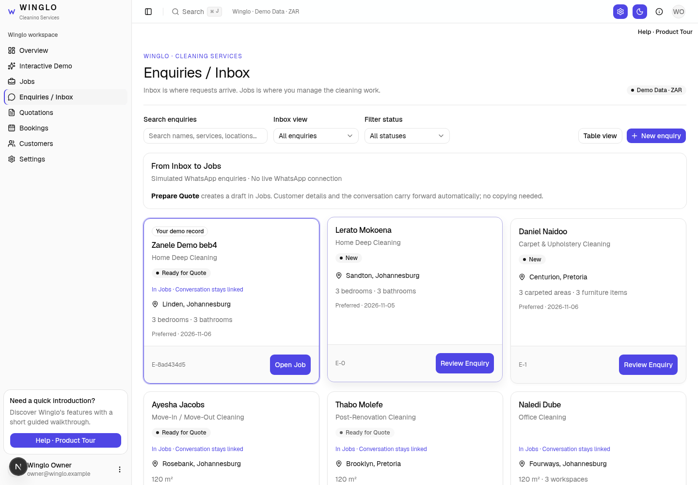
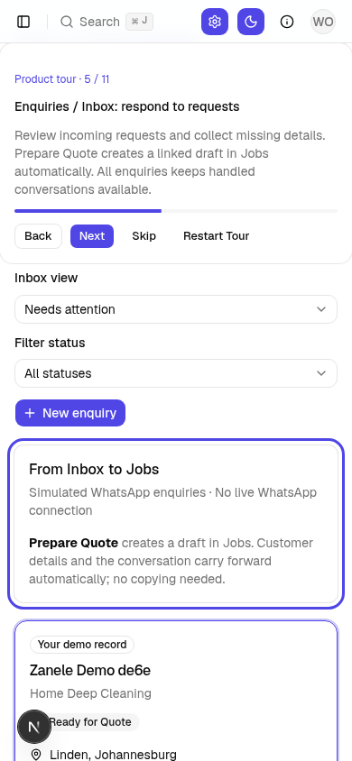

# Winglo — Inbox to Jobs

**Inbox is where requests arrive. Jobs is where you manage the cleaning work.**

1. The live demo simulates a WhatsApp enquiry and sends its details to **Enquiries / Inbox**.
2. Review missing details, then choose **Prepare Quote**. One linked draft is saved; the customer and conversation stay connected.
3. Continue in **Jobs** to review/send the quote, simulate customer acceptance, book the cleaning and complete the work.

The Inbox defaults to **Needs attention**. Prepared requests leave this queue; **All enquiries** keeps handled conversations accessible. Jobs contains prepared quotations and bookings, rather than duplicating unquoted requests.

## Inbox and linked handoff

## Walkthrough on mobile

The Help tour includes separate Inbox and Jobs steps. Tour progress is independent from customer records and active demo progress.

There is no live WhatsApp connection. All records remain saved in this browser only.

Rollback before this change: `backup/pre-inbox-handoff-2026-11-05`, commit `9d47e4dd308eb8d1f5cc52a94e6008a5027707e8`.
