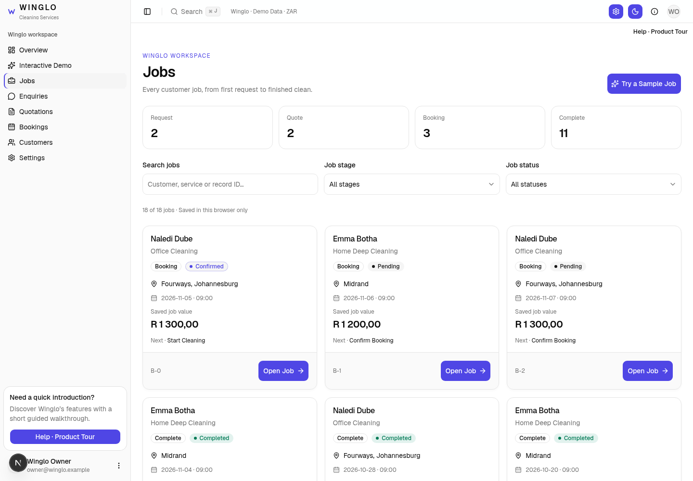
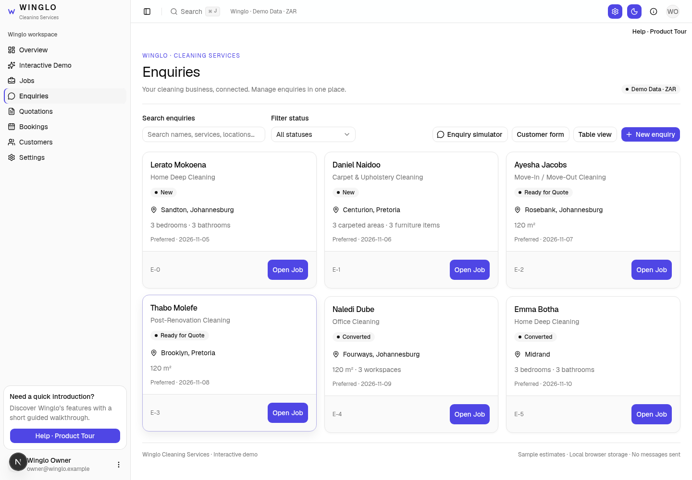
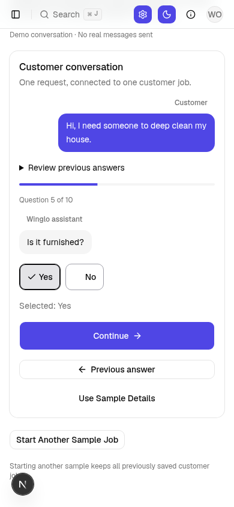
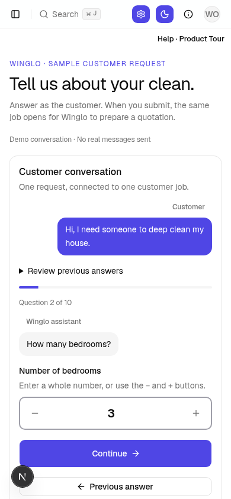
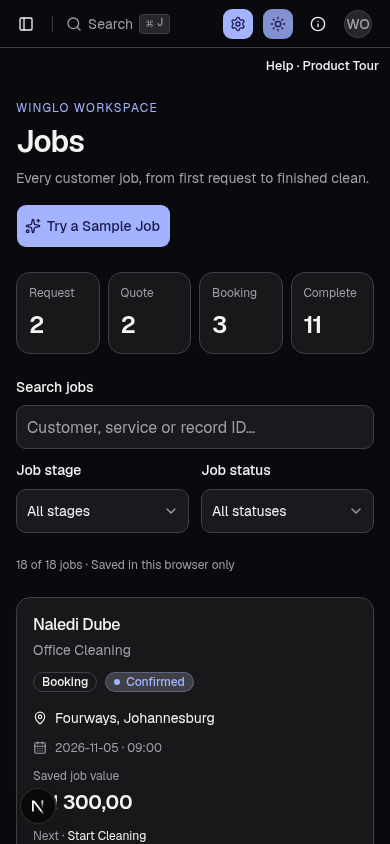

# Winglo — Jobs and visual refinements

Screenshots from the working dashboard. The update keeps the connected job workflow, browser-local records, calendar, themes and animations.

## Jobs on desktop

Search and filter all saved customer jobs, then open the same Request → Quote → Booking → Complete workspace. Multiple jobs for one customer remain separate.

## Compact enquiry cards

Names, service details, status and next action are easier to scan. Desktop Table view remains available.

[Quotation cards](../../artifacts/winglo-premium-quotations.png) · [Customer cards](../../artifacts/winglo-premium-customers.png)

## Clear selections

Grey fill, stronger border, checkmark and selection text make the chosen answer obvious.

## Clear number fields

Whole-number fields support direct typing and labelled − / + buttons. Measurements retain decimal input.

## Mobile and dark mode

The brand accent becomes lighter in dark mode; selected answers remain neutral grey. Success and cancellation keep distinct status colours.

[Selected answer in dark mode](../../artifacts/winglo-premium-demo-dark.png) · [Customers on mobile](../../artifacts/winglo-premium-customers-mobile-dark.png)

## Rollback

Pre-update code: branch `backup/pre-premium-jobs-2026-11-05`, commit `dff5bc5319e104a6bd8df277066456d5125b24c5`. Browser-local records are stored separately from the code backup.
