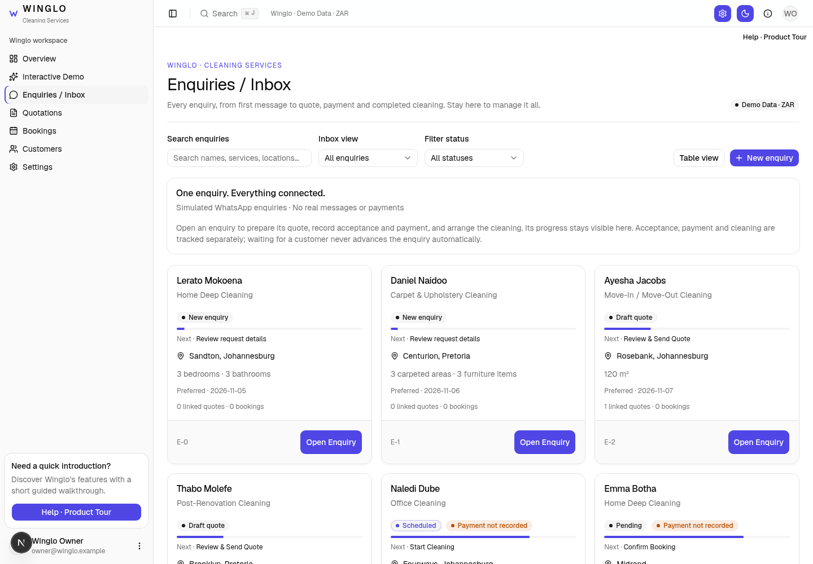
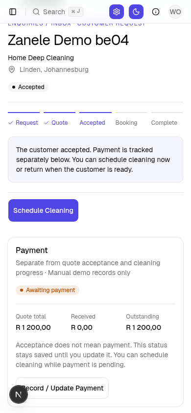
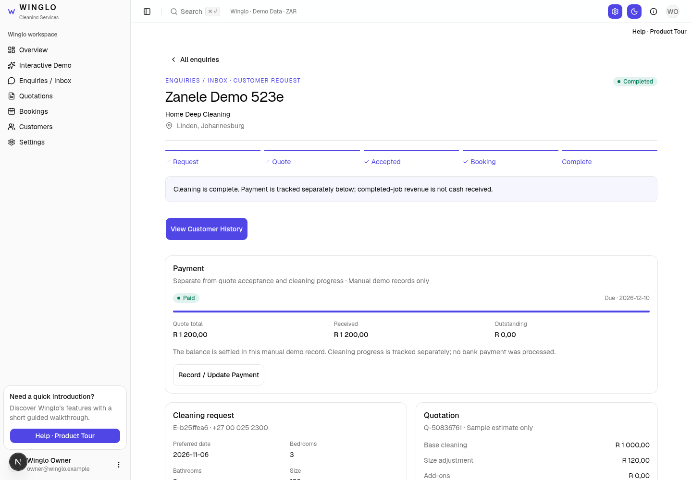
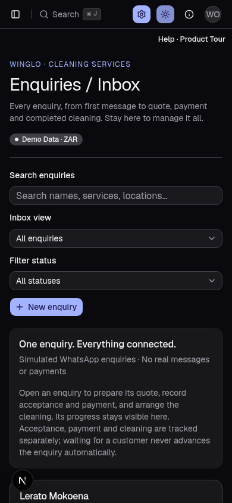

# Winglo — One enquiry, everything connected

The separate Jobs section is removed. **Enquiries / Inbox** is the main place to manage each customer request, quote, acceptance, payment and cleaning.

## The enquiry list

Every enquiry remains visible, with a progress bar, current state, payment status and next action. Search and progress/payment filters help locate work that is waiting. Closed requests remain available in All enquiries.

## Waiting is a real, saved state

An accepted quote is not automatically paid. It can remain Awaiting payment for days. You may schedule cleaning while payment is pending; no pay-before-booking policy is imposed. Manual records support partial receipts, the outstanding balance and an optional due date.

## Everything stays linked

The enquiry workspace connects its customer, collected conversation details, quotations, bookings and recorded activity. Additional quotes can be created deliberately without replacing the original quote or its payment record.

## Mobile and dark mode

Bookings remains the schedule/calendar view. Quotations remains the place to view accepted/pending quotes and create additional ones. Old Jobs links redirect to the corresponding enquiry.

Payment entries are manual demo records, not processed or verified bank transactions. Existing accepted records without payment history show Payment not recorded. Completed-job revenue still represents completed work, not cash received.

The Help walkthrough explains the unified enquiry flow and independent payment/cleaning progress. Existing records and tour progress are preserved.

Rollback: `backup/pre-unified-enquiries-2026-11-05` at `6210424`.
